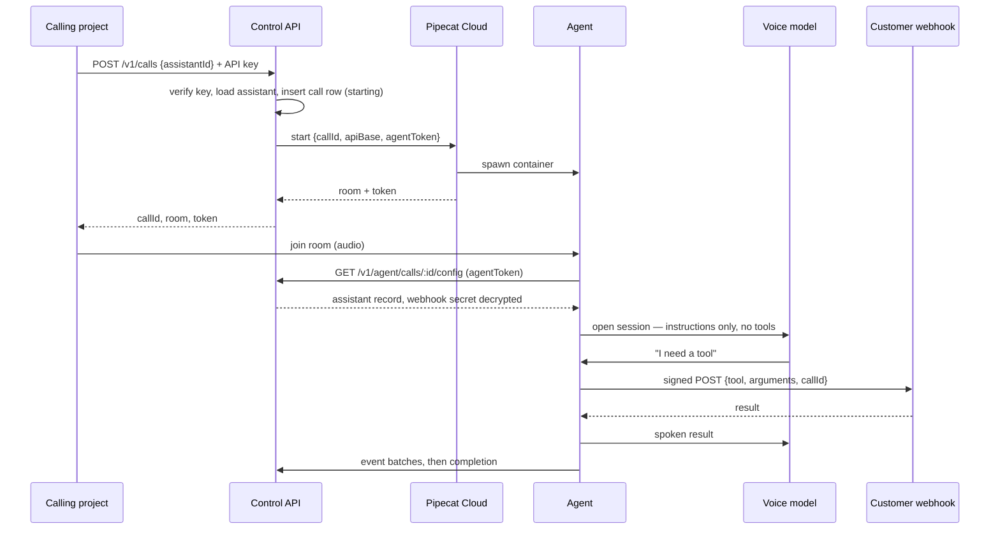

# Architecture

Current boundaries. The workspace, control API, database schema, and Pipecat agent are implemented and proven locally. Vercel/Neon repository configuration exists, but the owner dashboard setup and first internet deployment remain blocked; `CONTEXT.md` owns current status.

## The shape in one paragraph

A project holds an API key and asks the control API to start a call against one of its assistants. The control API verifies the key, loads the assistant, writes a call row, and asks Pipecat Cloud to spawn an agent. The agent fetches the assistant's full record back from the control API over a short-lived token, opens a session with the voice model carrying instructions and no tools, and runs the call. When the voice model needs something done, a backend text model — owned by the platform, holding the assistant's tools — picks a tool and calls the customer's webhook with a signed request. The result is spoken back while the caller keeps talking. The agent reports transcript and tool events to the control API as it goes, and reports completion at the end.

## Components

```
                        ┌──────────────────────────────────────────┐
  the user's team ──────┤ apps/workspace  (Next.js on Vercel)       │
  (browser)             │                                          │
                        │   workspace UI: assistants, keys, calls   │
  Boring Host, Dorian ──┤   control API:  /v1 route handlers        ├──── Postgres (Neon)
  (API key)             │                                          │      via Drizzle
                        └───────────────┬──────────────────────────┘
                                        │ start call / config / events
                        ┌───────────────┴──────────────────────────┐
  caller ── audio ──────┤ agent/  (Python, Pipecat, on Pipecat Cloud)│
  (browser, WebRTC)     │                                           │
                        │   voice model: instructions, no tools      │
                        │   backend model: holds the assistant's     │
                        │                  tools, calls webhooks ────┼──── customer's server
                        └───────────────────────────────────────────┘
```

### `apps/workspace` — workspace and control API

One Next.js app, deployed to Vercel serverless functions. It holds two surfaces that share a database client and an auth layer:

- **Workspace**, for humans: sign in, create and edit assistants, mint and revoke API keys, browse calls, transcripts, and usage. Login is Better Auth against the platform's own Postgres.
- **Control API**, for machines: route handlers under `/v1`. Start a call against an assistant with an API key, receive events, read per-key records and metering.

They are one deploy because the control API checks a key, loads a record, calls one upstream, and writes rows — a second service would buy two deploys and cross-service auth for no benefit at this size. Live media and long-lived connections belong to the Pipecat agent, so the platform request layer has no server-lifetime requirement. [ADR 011](docs/decisions/011-vercel-hosting.md) records the hosting decision.

### `agent/` — the Pipecat agent

One data-driven agent image, not one image per assistant. Per call it loads the assistant record and builds the pipeline: the voice model in client delegation, a backend text model through OpenAI's Responses API holding the assistant's tools, and each tool a signed webhook call to the assistant's server URL.

A Python `uv` project outside the pnpm workspace. Pipecat is a pinned dependency, never vendored or forked: every upstream fix for providers, turn detection, and transports would otherwise become a manual merge.

The backend model is called through the **Responses API**, not chat completions. Current reasoning models reject function tools on chat completions with a 400, and Pipecat's backend worker turns that error into an empty answer — the gate spike failed exactly this way before the fix.

### Practice configuration foundation

Practice uses the same delegated tool contract with a platform-owned endpoint,
not a browser mock or second agent runtime. A compiler freezes only allowed
assistant fields, reviewed synthetic samples, the assistant/sample revisions
and a versioned disclosure into an immutable snapshot. Its digest excludes
runtime credentials and volatile timestamps. The Practice database read omits
the customer's URL and secret entirely.

Assistant and sample writes use revision compare-and-swap. The signed Practice
endpoint accepts only an active, unexpired Practice call, validates the frozen
tool schema and persists the chosen response before returning it, so identical
delivery retries replay one result and conflicting reuse is rejected. The
per-call Practice secret is encrypted separately and can be purged without
changing the authored digest. [ADR 012](docs/decisions/012-practice-snapshots.md)

### Disabled Sandbox admission foundation

Workspace-authenticated Sandbox preparation is durable but cannot execute. A
transaction freezes the Practice snapshot, creates a call and attempt, claims
one per-user slot, and consumes atomic per-user/account quota. A stable client
UUID plus canonical input digest makes identical retries return the same
attempt; changed input conflicts. Only a hash of the tab's controller proof is
stored.

Reservations expire after 30 seconds and can be canceled before dispatch. Safe
current/status reads expose no snapshot, proof, token or provider identifier.
Start, join and presence terminate at a hard-disabled server boundary that has
no provider client or token-mint dependency. The stop path cannot cross into
provider cleanup. This is an additive foundation, not an enabled Sandbox:
provider dispatch, agent registration, join credentials, runtime protocol and
cleanup remain absent pending the external safety gate. [ADR 013](docs/decisions/013-disabled-sandbox-admission.md)

### Sandbox browser preparation

The assistant-local Sandbox renders account-scoped saved configuration and compiler validation, then uses the existing session/Origin/CSRF-protected admission routes. The client retains retry input and a controller proof in tab memory, never browser storage. It has no provider start or join integration. Local microphone checks and synthesized test tones stay on the device and release resources on completion, cancellation, tab hiding and navigation. Workspace-only call projections include source/test mode so Practice reservations remain labeled in history; public integration API projections are unchanged.

## Lifecycle of one call



Two things in that diagram are load-bearing rather than incidental.

**The agent fetches its own config** instead of receiving the assistant record in the start request. The agent must report the call back regardless, so an authenticated agent-to-platform channel exists either way; given it exists, config over the same channel costs one endpoint, keeps the customer's webhook secret out of a third party's control-plane logs, and keeps configuration fresh at call time rather than frozen at dispatch.

**Waiting behaviour is a field on the assistant**, folded into the voice model's instructions like accent. The platform injects no filler speech of its own. The gate measured acknowledge-then-silence at a five-second wait and real conversation-filling at longer ones; it is a prompt knob, so it is exposed as one rather than being simulated by the platform speaking on the customer's behalf.

## Trust boundaries

Four parties, and the whole design is about keeping authority where it belongs.

**The caller** is untrusted. Everything they say is input. Transcript text is never treated as an instruction to a model or to a webhook; it is data the customer's backend interprets.

**The voice model** holds no authority and no tools. It sees the current call's audio, transcript, and instructions. It decides when to speak and when to signal for help; it never decides what is true or what action to take, and it is never given a tool definition, a credential, or a tenant identifier. A caller cannot talk it into an action because it has no action to take.

**The platform** is the custodian. It holds the assistant record, the account's API keys, and — on the customer's behalf — the webhook secret. That custody is the platform's sharpest obligation: the secret is encrypted at rest, decrypted only when an agent fetches config, and never returned to the workspace, never logged, never in an error message.

**The customer's backend** is the authority. It owns permissions, tool execution, confirmations, and business records. It is reached only by a signed webhook, and it decides what to do with what it is asked. An API key authenticates a customer to the platform; it authorizes nothing on the customer's side. What a caller may do is the customer's decision, made with the customer's own identity, never from anything in the transcript.

## Persistence

_The schema and its read/write paths exist and are applied by committed migrations._

Postgres on Neon, through Drizzle, with migrations generated and committed.
Everything is owned by an account; there is no global object. Calls carry
explicit source/channel provenance. Sandbox attempts own idempotency and
controller-proof hashes; Sandbox slots and admission counters provide durable,
atomic concurrency and quota boundaries.

Three rules in that schema are decisions rather than detail:

- **A key is stored as a prefix plus a SHA-256 hash**, never the key itself. It is shown once at creation and is not recoverable afterwards. Lookup is by prefix, then a constant-time hash comparison. Revocation is a soft delete, so a revoked key's calls stay attributable.
- **A call carries a snapshot of the assistant it ran against.** Editing an assistant tomorrow must not silently rewrite what yesterday's call did; the transcript would stop matching the instructions that produced it.
- **Call states are honest.** `ended` is written only by the agent reporting completion. Read paths derive a stale active call as `incomplete` immediately; an authenticated external sweep persists that observation later. Scheduler delay therefore postpones persistence, not truth in the UI or API.

Audio is not stored, and neither is the raw provider event stream: one is a recording feature nobody has asked for and a compliance surface, the other is debugging noise that would dwarf the useful rows.

## What would change this

A second voice provider is an adapter swap inside Pipecat rather than a platform change, which is most of the point of choosing it — `docs/decisions/009-gemini-live-candidate-provider.md` names the candidate. What would genuinely reopen the architecture is Pipecat's client delegation regressing or being dropped, or Pipecat Cloud pricing making per-minute margins impossible; [ADR 010](docs/decisions/010-pipecat-runtime.md) records both and names the resume point for an in-house engine. Either is an ADR, not a quiet refactor.
