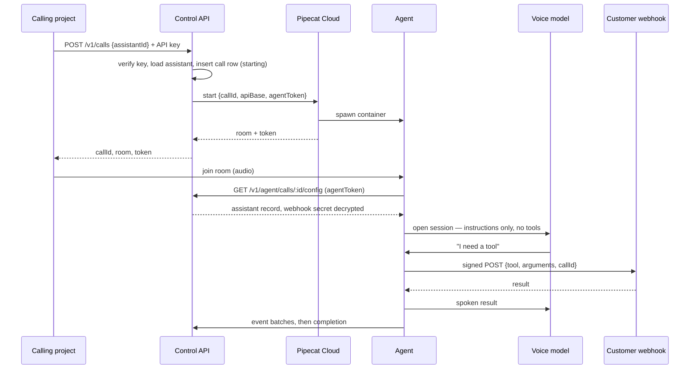

# Architecture

Target boundaries. Most of this describes the system as it should exist once the platform milestone lands, not what exists today — `CONTEXT.md` owns status. Every section that describes machinery is marked *Planned* where it is not yet built; the two that state trust rules and what would reopen the design are not marked, because they are constraints on whatever gets built rather than claims about what exists. What exists at this commit is the decision trail, the CI workflow, and the Pipecat gate spike.

## The shape in one paragraph

*Planned. This is the system P02 through P05 build, described in the present tense for readability; none of it runs at this commit.*

A project holds an API key and asks the control API to start a call against one of its assistants. The control API verifies the key, loads the assistant, writes a call row, and asks Pipecat Cloud to spawn an agent. The agent fetches the assistant's full record back from the control API over a short-lived token, opens a session with the voice model carrying instructions and no tools, and runs the call. When the voice model needs something done, a backend text model — owned by the platform, holding the assistant's tools — picks a tool and calls the customer's webhook with a signed request. The result is spoken back while the caller keeps talking. The agent reports transcript and tool events to the control API as it goes, and reports completion at the end.

## Components

*Planned. None of this exists at this commit.*

```
                        ┌──────────────────────────────────────────┐
  the user's team ──────┤ apps/workspace  (Next.js, Node server)    │
  (browser)             │                                          │
                        │   workspace UI: assistants, keys, calls   │
  Boring Host, Dorian ──┤   control API:  /v1 route handlers        ├──── Postgres (Neon)
  (API key)             │                                          │      via Drizzle
                        └───────────────┬──────────────────────────┘
                                        │ start call / config / events
                        ┌───────────────┴──────────────────────────┐
  caller ── audio ──────┤ agent/  (Python, Pipecat, on Pipecat Cloud)│
  (browser, WebRTC)     │                                           │
                        │   voice model: instructions, no tools      │
                        │   backend model: holds the assistant's     │
                        │                  tools, calls webhooks ────┼──── customer's server
                        └───────────────────────────────────────────┘
```

### `apps/workspace` — workspace and control API

One Next.js app, deployed as a Node server rather than serverless. It holds two surfaces that share a database client and an auth layer:

- **Workspace**, for humans: sign in, create and edit assistants, mint and revoke API keys, browse calls, transcripts, and usage. Login is Better Auth against the platform's own Postgres.
- **Control API**, for machines: route handlers under `/v1`. Start a call against an assistant with an API key, receive events, read per-key records and metering.

They are one deploy because the control API checks a key, loads a record, calls one upstream, and writes rows — a second service would buy two deploys and cross-service auth for no benefit at this size. A Node server rather than serverless keeps live event streaming available later without a rewrite. Recorded in the tech plan's decision table.

### `agent/` — the Pipecat agent

*Lands in P04. Does not exist at this commit; `spikes/pipecat-gate/` is the working precedent.*

One data-driven agent image, not one image per assistant. Per call it loads the assistant record and builds the pipeline: the voice model in client delegation, a backend text model through OpenAI's Responses API holding the assistant's tools, and each tool a signed webhook call to the assistant's server URL.

A Python `uv` project outside the pnpm workspace, following the layout `spikes/pipecat-gate/` already proves. Pipecat is a pinned dependency, never vendored or forked: every upstream fix for providers, turn detection, and transports would otherwise become a manual merge.

The backend model is called through the **Responses API**, not chat completions. Current reasoning models reject function tools on chat completions with a 400, and Pipecat's backend worker turns that error into an empty answer — the gate spike failed exactly this way before the fix.

## Lifecycle of one call

*Planned. The provider half — delegate, keep talking, relay — is the part the gate spike already proved.*



Two things in that diagram are load-bearing rather than incidental.

**The agent fetches its own config** instead of receiving the assistant record in the start request. The agent must report the call back regardless, so an authenticated agent-to-platform channel exists either way; given it exists, config over the same channel costs one endpoint, keeps the customer's webhook secret out of a third party's control-plane logs, and keeps configuration fresh at call time rather than frozen at dispatch.

**Waiting behaviour is a field on the assistant**, folded into the voice model's instructions like accent. The platform injects no filler speech of its own. The gate measured acknowledge-then-silence at a five-second wait and real conversation-filling at longer ones; it is a prompt knob, so it is exposed as one rather than being simulated by the platform speaking on the customer's behalf.

## Trust boundaries

Four parties, and the whole design is about keeping authority where it belongs.

**The caller** is untrusted. Everything they say is input. Transcript text is never treated as an instruction to a model or to a webhook; it is data the customer's backend interprets.

**The voice model** holds no authority and no tools. It sees the current call's audio, transcript, and instructions. It decides when to speak and when to signal for help; it never decides what is true or what action to take, and it is never given a tool definition, a credential, or a tenant identifier. A caller cannot talk it into an action because it has no action to take.

**The platform** is the custodian. It holds the assistant record, the account's API keys, and — on the customer's behalf — the webhook secret. That custody is the platform's sharpest obligation: the secret is encrypted at rest, decrypted only when an agent fetches config, and never returned to the workspace, never logged, never in an error message.

**The customer's backend** is the authority. It owns permissions, tool execution, confirmations, and business records. It is reached only by a signed webhook, and it decides what to do with what it is asked. An API key authenticates a customer to the platform; it authorizes nothing on the customer's side. What a caller may do is the customer's decision, made with the customer's own identity, never from anything in the transcript.

## Persistence

*The schema exists and is applied by committed migrations. The tables below are real; the code that reads most of them is not written yet.*

Postgres on Neon, through Drizzle, with migrations generated and committed. Everything is owned by an account; there is no global object. The tables are accounts and users, API keys, assistants, calls, and call events.

Three rules in that schema are decisions rather than detail:

- **A key is stored as a prefix plus a SHA-256 hash**, never the key itself. It is shown once at creation and is not recoverable afterwards. Lookup is by prefix, then a constant-time hash comparison. Revocation is a soft delete, so a revoked key's calls stay attributable.
- **A call carries a snapshot of the assistant it ran against.** Editing an assistant tomorrow must not silently rewrite what yesterday's call did; the transcript would stop matching the instructions that produced it.
- **Call states are honest.** `ended` is written only by the agent reporting completion. A call whose container died is `incomplete` with its last known duration, written by a sweeper, and the workspace says so rather than showing a tidy record of something that never happened. This is the one idea from the retired engine worth carrying forward intact.

Audio is not stored, and neither is the raw provider event stream: one is a recording feature nobody has asked for and a compliance surface, the other is debugging noise that would dwarf the useful rows.

## What would change this

A second voice provider is an adapter swap inside Pipecat rather than a platform change, which is most of the point of choosing it — `docs/decisions/009-gemini-live-candidate-provider.md` names the candidate. What would genuinely reopen the architecture is Pipecat's client delegation regressing or being dropped, or Pipecat Cloud pricing making per-minute margins impossible; [ADR 010](docs/decisions/010-pipecat-runtime.md) records both and names the resume point for an in-house engine. Either is an ADR, not a quiet refactor.
