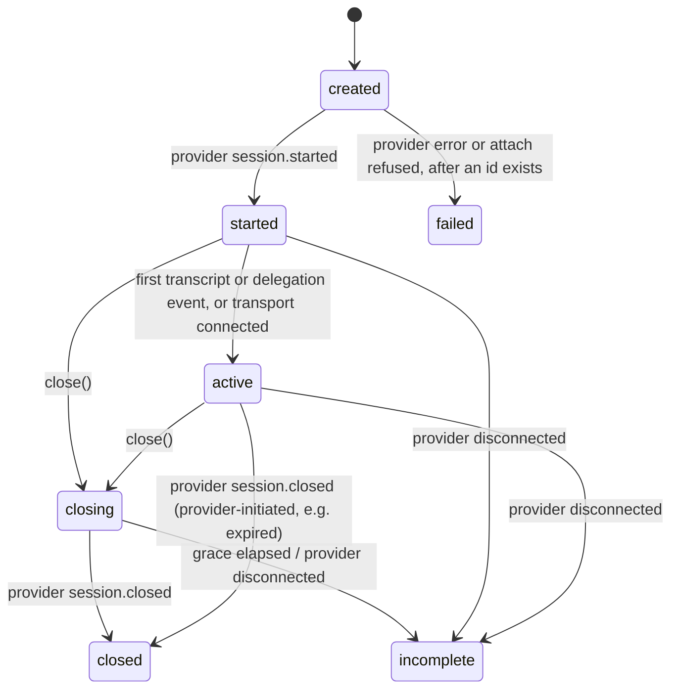

# Tech doc: packages/core

The library. Session state machine, transcript store, delegation broker, provider adapter interface, a scripted fake provider for tests, and the GPT-Live WebSocket adapter. No HTTP server, no database, no transport envelope code. Usable in a consumer's own process with an in-process handler.

Package name `@duplexd/core`. Depends on `@duplexd/contracts`. The GPT-Live adapter depends on the `openai` SDK and `ws`; it lives in a subpath export (`@duplexd/core/providers/openai-gpt-live`) so a consumer using only the fake provider does not load the SDK.

## Public surface

```
createSession(config: SessionConfig, deps: {
  provider: ProviderAdapter
  handler: HandlerInvoker              // in-process function, or createRemoteHandler(...)
  clock?: Clock                        // injectable for timeout tests
  tokenCounter?: TokenCounter          // injectable; default documented below
  logger?: Logger
}): Session

interface Session {
  readonly id: string | undefined       // provider session id once started; never minted locally
  readonly state: SessionState
  start(init: { mode: "websocket" } | { mode: "attach", sessionId: string }): Promise<void>
  close(): Promise<void>                // requests close; resolves when terminal
  events(opts?: { raw?: boolean }): AsyncIterable<CoreEvent>
  on(listener: (e: CoreEvent) => void): () => void
  transcript(): TranscriptFragment[]    // snapshot
  delegations(): DelegationSummary[]
}

type HandlerInvoker = (req: HandlerRequest, signal: AbortSignal) => AsyncIterable<HandlerResult> | Promise<AsyncIterable<HandlerResult>>

createRemoteHandler(opts: { url, auth, fetch?: typeof fetch }): HandlerInvoker
```

`createRemoteHandler` composes the contract package's signer and NDJSON parser over `fetch`. It performs no retries: a failed or aborted request is one delegation error, never a second POST (one owner per side effect). It calls `fetch` with `redirect: "error"`, so a 3xx from the handler is a delegation error (`error: "redirect_refused"`) and can never move the request to another host or downgrade to plain HTTP; the URL rule itself (`https:` unless loopback) is enforced by the `SessionConfig` schema before a session exists. A parser `NdjsonLineTooLong` is a delegation error (`error: "ndjson_line_too_long"`) and aborts the request.

`start()` has two failure shapes, and they are deliberately different. If the adapter cannot allocate a provider session id (WebSocket mode: the connection or `session.start` fails before `session.started`), `start()` rejects with `SessionCreationError`, the session emits no event, `id` stays `undefined`, the state stays `created`, and the object is discarded; a second `start()` is rejected. Once an id exists, any failure before `started` (an `error` provider event, an attach that is refused) moves the session to `failed` and emits `session.failed` with that id. The split exists because every core event and every record is keyed by the provider id, and `AGENTS.md` forbids minting one.

## Session state machine



Rules:

- Only the core moves state. Transports and handlers call `close()`; nothing else.
- `closed` requires the provider's `session.closed`. `close()` sends `session.close`, then waits `closeGraceMs` (default 10 000) for `session.closed`. If it does not arrive, or the connection drops first, the state is `incomplete` with the matching reason. `AGENTS.md`: `session.closed` is the only completion.
- Usage is recorded only from `session.closed.usage`. `session.usage.updated` snapshots are exposed on `provider.raw` only.
- `failed` is only reachable before `started`, and only once a provider id exists. A creation attempt the provider rejects before allocating an id is not a transition: `start()` throws and the session stays `created` with no event. After `started`, every ending is `closed` or `incomplete`.
- `incomplete { reason: "instance_lost" }` is never produced by the core; it is the server's sweeper describing a process that is gone (see [server-api.md](server-api.md)).
- Entering `closing` cancels every running delegation (`outcome: "cancelled"`) and aborts their invokers.
- Every transition emits the matching core event with a monotonic `seq`.

## Transcript store

Ordered fragments `{ role, text, offsetMs, seq }`, appended from provider transcript deltas. `offsetMs` comes from the provider's `offset_ms` when present; when a delta carries none, the store uses the last known offset. The store is per session, in memory, and exposed as an immutable snapshot for `HandlerRequest` construction. It never interprets text.

## Delegation broker

Per-session map `delegationId → { state: running | finished, outcome?, appends, abort }`.

On `delegation.created` from the provider:

1. Record the id. Duplicate ids from the provider are logged and ignored (the first wins).
2. Build `HandlerRequest`: transcript snapshot, `consumerContext` from config, `priorDelegations` = every other id seen, with its outcome or `running`.
3. Start the timeout (ADR 007) and invoke the handler with an `AbortSignal`. Keepalive lines from a remote handler do not restart or extend it.
4. Pull one item at a time; the next pull starts only after the current item has been forwarded (ack received) or rejected. For each item: validate the shape; `done` finishes with `outcome: "done"`; `error` finishes with `outcome: "error"`; otherwise check `content` against `MAX_CONTENT_CHARS` and then count tokens against `APPEND_TOKEN_BUDGET`, and either send the matching append or emit `append.rejected { reason: "over_budget" }` (with `chars` or `tokens`) and continue consuming.
5. Clean stream end without `done` is `done`. A read that fails (reset, redirect, oversized line, malformed line) is `error`. Timeout finishes with `timeout`. Invoker throwing before the first item is `error`.

Finishing, for every outcome, in this order and without waiting on the handler:

1. Mark the delegation finished. Nothing from it is forwarded from this point.
2. Stop reading: abort the signal, call the iterator's `return()` without awaiting it, and for the remote form abort the `fetch`. The broker never drains an uncooperative handler; a `return()` that blocks because the handler is mid-await is left to resolve on its own.
3. Emit `delegation.finished`.

Anything the handler produces after step 2 is never read, so it cannot be counted and never appears in an event or record. If a pull that was in flight resolves after step 3 with an item, the broker logs it at debug level (delegation id and item kind only) and does nothing else. There is deliberately no count of late items: the broker stops reading, so any number it reported would be wrong.

Timeout, precisely: the broker stopped waiting and stopped forwarding. Items forwarded before the deadline stand, and the model may have spoken them. The broker generates no append of its own on timeout, ever. Whether the consumer's work completed is unknown to the broker and the event does not claim otherwise (ADR 007). So "nothing spoken on the consumer's behalf" in `docs/MILESTONE.md` means no broker-generated content; it does not mean the delegation produced no speech, because a handler that sent `commentary` and then hung has already been heard.

Appends:

- `thinking` and `commentary` carry the delegation id; `instruction` always carries `delegation_id: null` on the wire but is attributed to the delegation in the `append.sent` event.
- Over either content limit is `append.rejected { reason: "over_budget" }`, never truncated. The handler is not told; the event stream and the call record show it.
- The broker refuses to append against an id it has not seen (`unknown_delegation`) and against a finished one (`delegation_finished`). Both are unreachable through the handler path by construction and exist for a future direct-append API; they are tested through the adapter seam.
- An append the provider rejects (error event correlated by `event_id`) is `append.rejected { reason: "provider_error" }`.
- `append()` resolves on the provider's `appended` ack; the ack is not treated as evidence the model spoke anything (verified caveat in provider docs).

Concurrency: the provider may emit a second delegation before the first finishes; the broker runs both, keys everything by id, and never serializes them. This is not documented on the provider side (see [provider-facts.md](provider-facts.md)); the broker supports it regardless.

Token counting: the default `TokenCounter` uses a BPE tokenizer with the `o200k_base` encoding, which is unverified as the provider's encoding. T05 sends an append that this counter measures at 501 tokens and records whether the provider accepts or rejects it, which is the only way to learn what "500 tokens" means on the provider side. The count is a guard, not a guarantee; a provider-side rejection is surfaced as its own reason so the mismatch is observable. The counter is injectable so tests use a deterministic word-count stub.

## Provider adapter interface

```
interface ProviderAdapter {
  start(init: ProviderStart): Promise<{ sessionId: string }>     // WebSocket mode: session.start → session.started
  attach(sessionId: string): Promise<void>                       // observe and control an existing session
  abandon(sessionId: string): Promise<AbandonResult>             // best-effort close of a session this adapter is not attached to
  events(): AsyncIterable<ProviderEvent>
  append(kind: AppendKind, delegationId: string | null, content: string): Promise<void>
  close(): Promise<void>                                         // send session.close; do not wait
  disconnect(): void
  sendAudio?(chunk: Uint8Array): void                            // WebSocket audio only
}

type AbandonResult = { closed: true } | { closed: false, reason: string }

type ProviderEvent =
  | { type: "started", sessionId }
  | { type: "transcript", role, text, offsetMs? }
  | { type: "delegation", delegationId, offsetMs }
  | { type: "closed", reason, usage: Usage }
  | { type: "error", message, correlatedEventId? }
  | { type: "disconnected", reason? }
  | { type: "raw", event }
  | { type: "audio", chunk }                                     // WebSocket audio only
```

`abandon` exists for one case: the server created a provider session over REST, could not attach, and now owns a live provider session with no control channel. The adapter does whatever the provider offers to close it (a REST delete if one exists, a short-lived attach followed by `session.close` otherwise) and reports honestly whether it worked. Whether a REST close exists is unverified (see [provider-facts.md](provider-facts.md)); T08 finds out.

The normalized `ProviderEvent` is internal to core, not a contract shape. A second provider implements this interface and nothing else.

### Fake provider

`@duplexd/core/testing` exports `createFakeProvider(script)`. A script is a list of steps: `emit(event)`, `waitForAppend(kind, delegationId?)`, `delay(ms)`, `rejectNextAppend(error)`, `disconnect()`, `rejectStart(error)`, `rejectAttach(error)`. It records every append and every `abandon` call it receives. It drives every broker and FSM unit test and the server's tests.

### GPT-Live WebSocket adapter

`createOpenAiGptLiveAdapter({ apiKey, fetch?, WebSocket? })`. Implements `start` via `wss://api.openai.com/v1/live/sessions` with `session.start { model: "gpt-live-1", delegation: { type: "client" }, instructions, voice?, audio? }` and `attach` via `wss://api.openai.com/v1/live/sessions/{id}/attach` (both verified). Maps provider events to `ProviderEvent` per the table in `docs/PROTOCOL.md`; every provider event also passes through as `raw`.

The adapter is the single place provider event names live; they are string constants in one module so a rename after verification touches one file.

Unverified items the adapter ticket must confirm and record (see [provider-facts.md](provider-facts.md)): the `openai` version to pin, whether `LiveWS` or the SDK's `sideband` helper covers attach or raw `ws` is needed, exact `session.start` audio field names, the error shape for an unknown `delegation_id`, the full `usage` object, the provider's response to a 501-token append, and, load-bearing for the whole server design, that `session.delegation.created` is delivered on an attach connection. The last one moved from T08 to T05 because T06 and T07 are built on it and T05 is the first ticket that can open both a primary and an attach socket on one session.

## Tests

`pnpm --filter @duplexd/core test`, all against the fake provider unless stated:

- FSM: every transition in the diagram, every illegal transition rejected, `closed` only after `session.closed`, `incomplete` on disconnect and on grace expiry, `failed` only before `started` and only with an id; `start()` against a fake whose `start` rejects before returning an id throws `SessionCreationError`, emits nothing, and leaves `id` undefined; a fake whose `start` returns an id and then emits `error` before `started` produces `session.failed` carrying that id.
- Broker: single delegation happy path; two concurrent delegations with interleaved results routed by id; silent-hang timeout with the injected clock (zero appends, one finished event); commentary-then-hang timeout (the append before the deadline was sent, none after, no broker-generated append, `outcome: "timeout"`); keepalives past the deadline do not extend it; a late in-process yield from a handler that ignores the abort signal is not forwarded and does not delay the finished event; the remote reader is aborted on finish (asserted through the counting fetch stub's signal); over-`MAX_CONTENT_CHARS` and over-token items each rejected and the rest of the stream continues; stream without `done`; `error` item; invoker throws; close mid-delegation cancels and aborts; duplicate provider delegation id ignored; `instruction` sent with null id; `priorDelegations` includes `running`.
- Remote handler client: signs correctly (vectors), sends metadata headers equal to the body, consumes NDJSON with keepalives, aborts on signal, never retries on failure, non-200 is `error`, a 3xx is `error` with `redirect_refused` and no second request, an oversized line is `error` with `ndjson_line_too_long`.
- Adapter: mapping tests over recorded provider event fixtures (fixtures captured from the live session in T05, with ids scrubbed).

Live: one recorded session against the real provider over WebSocket with a trivial in-process handler, driven by a short synthetic PCM clip that asks for something the instructions say to delegate. The clip is generated at test time by the provider's text-to-speech endpoint from a committed transcript, using the same `OPENAI_API_KEY`, and cached in a gitignored directory; the generation script and the transcript are committed, the audio is not. Which TTS model and endpoint is unverified and is recorded by T05. Session id in the PR. Provider access missing means the live item is reported blocked, not skipped silently.

The same live session opens a second, attach connection to itself and asserts that `session.delegation.created` arrives on it, sends one deliberately 501-token append (by the default counter) and records the provider's response verbatim, and sends one append with an unknown `delegation_id` and records that too.

## Acceptance evidence

Report each as passed, failed, blocked, or not run:

- `pnpm --filter @duplexd/core lint`, `typecheck`, `test` pass from a clean clone.
- Two concurrent delegations are tracked separately and results route to the right one (tested with the fake provider).
- Handler timeout produces `delegation.finished { outcome: "timeout" }` and the broker generates no append of its own, with the delay forced past the timeout: for the silent-hang fixture the fake provider records zero appends; for the commentary-then-hang fixture it records exactly the append sent before the deadline and none after; keepalives do not extend the deadline (all tested).
- An item over `MAX_CONTENT_CHARS` and an item over the token budget each produce `append.rejected { reason: "over_budget" }`, are not truncated, and the stream continues (tested).
- Session close waits for the provider's final event and records usage; a disconnect before it produces `incomplete`, not `closed` (tested).
- After any outcome the broker stops reading: a late in-process yield is never forwarded and never delays the finished event, and the remote request is aborted (tested).
- A provider that rejects creation before allocating an id makes `start()` throw with no event; a provider that fails after allocating one produces `session.failed` with that id (both tested).
- A handler that answers with a redirect produces one delegation error and no second request (tested).
- One recorded live WebSocket session against `gpt-live-1` with a delegation round trip, `session.delegation.created` observed on a second attach connection to the same session, the 501-token append response recorded, session id recorded, `openai` version pinned, the TTS model used for the clip named, and the verification of each unverified item written into `docs/PROTOCOL.md` (passed, or blocked with the reason).
- `ARCHITECTURE.md` and `docs/PROTOCOL.md` match the shipped core, in the same PRs.
