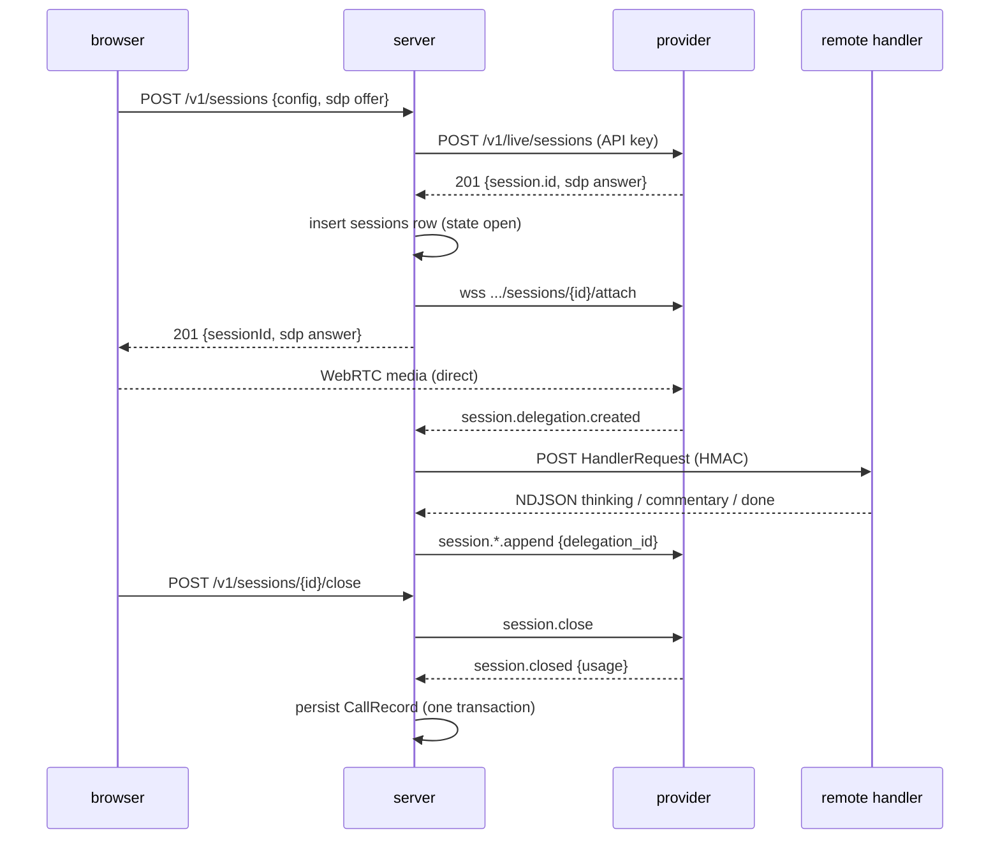

# API spec: apps/server

Fastify. Authenticates consumer API keys, creates sessions, exchanges WebRTC SDP, attaches to the provider for events, dispatches delegations to remote handlers, streams events to the console, persists call records. Stateless except for live sessions, which live in the process that owns their provider connection. One instance in milestone 1.

Package `@duplexd/server`. Depends on `@duplexd/contracts`, `@duplexd/core`, `@duplexd/transport-webrtc`, Fastify, Drizzle, `pg`.

## Configuration

Environment, names only (already in `.env.example`):

| Variable | Use |
| --- | --- |
| `OPENAI_API_KEY` | provider; read once at boot, never logged, never sent to any client |
| `DATABASE_URL` | Postgres |
| `DUPLEXD_API_KEYS` | comma-separated consumer keys for local development |
| `HANDLER_URL`, `HANDLER_SECRET` | default remote handler used when a session request omits `handler`; local development only, documented as a hosting gap (ADR 008). `HANDLER_URL` is checked at boot with the same rule as `SessionConfig.handler.url` (`https:` unless loopback) |
| `PORT` | default 8080 |

Boot validates the whole environment with a Zod schema and refuses to start on a missing key with a message that names the variable, not the value.

## Authentication

`Authorization: Bearer <key>` on every `/v1/*` route. Constant-time comparison against `DUPLEXD_API_KEYS`. Each session and record is owned by the key that created it, stored as a SHA-256 key fingerprint so listing and reads are scoped and the key itself is never at rest. Missing or wrong key: 401 `application/problem+json`.

## Routes

All bodies and responses are JSON unless stated. Errors are RFC 9457 problem details with a `code` field.

### `POST /v1/sessions`

Creates a provider session and a live duplexd session in one call.

Request:

```
{
  config: SessionCreateRequest     // SessionConfig with handler optional → server default from env; "in-process" is rejected (400 handler_not_supported)
  transport: { type: "webrtc", sdp: string }
}
```

`SessionCreateRequest` is the contract package's derived schema (see [contracts.md](contracts.md), "SessionConfig"). The server fills `handler` from `HANDLER_URL` and `HANDLER_SECRET` when it is absent and then validates the result as a full `SessionConfig` before anything reaches the core. The console never sends the secret and never sees it.

Response `201`:

```
{ sessionId: string, contractVersion: "1", transport: { type: "webrtc", sdp: string /* answer */ } }
```

The server posts the offer to the provider with `OPENAI_API_KEY`, receives the provider session id and answer, writes the session's start row (see "Persistence"), attaches to the session for events, registers it in the in-memory session registry, and returns. The browser gets the answer and the id, nothing else. The handler secret is held in memory on the session object and never returned, logged, or persisted.

One call rather than create-then-offer because the provider's WebRTC creation is the SDP exchange (verified).

A body whose `handler.url` breaks the URL rule (non-loopback `http:`) is 400 `invalid_config` with the schema's message; nothing is sent to the provider.

Provider failures split on whether an id exists. The split is deliberate: every event and record is keyed by the provider id, and none can be minted.

| Failure | Response | What happens |
| --- | --- | --- |
| `POST /v1/live/sessions` rejects or returns no id | 502 `provider_error` with the provider's message | Nothing. No session is registered, no core event exists, no row is written. One structured log line with the request id and the provider's status; no session id because there is none. |
| Creation returned an id, then attach fails | 502 `provider_error`, `detail: "attach_failed"` | The server calls the adapter's `abandon(id)` to close the provider session it cannot control, then emits `session.failed { reason: "attach_failed" }` and persists a `failed` record under the provider id whose `reason` says whether the abandon succeeded (`attach_failed; provider session closed` or `attach_failed; provider session not closed: <reason>`). The SDP answer is not returned, so the browser never completes media. |

The browser gets the answer and the id only on success.

### `GET /v1/sessions/:id`

Live session: `{ sessionId, state, createdAt, transcript, delegations, appendsCount }` from memory. Ended session: the persisted `CallRecord`. Unknown or not owned by this key: 404.

### `GET /v1/sessions/:id/events`

`application/x-ndjson`, one `CoreEvent` per line, for a live session, starting from `seq` 1 (the server keeps the session's full event log in memory for its lifetime) so a late-joining console sees the whole timeline. A whitespace keepalive line every 15 s while idle. Query `?raw=1` includes `provider.raw`. Ends with a final `session.closed`, `session.failed`, or `session.incomplete` event, then the stream closes. On an already-ended session the endpoint replays the persisted event log and closes.

The console consumes it with `fetch`, a stream reader, and the contract package's `parseNdjson` instantiated over `CoreEvent`, so the `Authorization` header can be sent and there is one line parser in the repo. The first draft chose SSE here; with `fetch` instead of `EventSource`, SSE's one advantage for a browser was gone and the choice left two stream encodings for no reason. Same encoding both ways is not an amendment to ADR 006, whose scope is the handler stream; ADR 006 notes it in its consequences.

### `POST /v1/sessions/:id/close`

`202`. Moves the session to `closing`; the terminal state arrives as an event. Idempotent: closing an already closing or ended session is 202.

### `GET /v1/sessions?limit=50&cursor=<endedAt|id>`

Persisted records for the key, newest first, `{ items: CallRecordSummary[], nextCursor? }` where the summary is the record without transcript, appends, and delegations. Sessions still open in the `sessions` table (see below) are not listed; they are live, and live sessions are served from memory.

### `GET /healthz`

`{ ok: true, db: "ok" | "down" }`, unauthenticated. Not a readiness signal for live sessions.

## Session lifecycle inside the server



The core owns the state machine and broker; the server wires `createSession` with the GPT-Live adapter, `createRemoteHandler`, and its logger. The server never touches delegation state directly. The server's design rests on the attach connection delivering `session.delegation.created`; T05 confirms that on a live session before T06 is merged.

On `SIGTERM`: stop accepting sessions, call `close()` on every live session, wait up to `closeGraceMs`, persist whatever is terminal, persist the rest as `incomplete { reason: "process_shutdown" }`, exit.

## Persistence

Drizzle, Postgres, migrations generated with `pnpm db:generate` and committed; `pnpm db:migrate` applies them. Docker compose provides local Postgres. The database is not a message bus and holds no live state beyond one thing: a row per started session, so a lost process leaves a trace.

Two writes per session:

1. **Start row.** Immediately after the provider returns an id and before attach, insert the `sessions` row with `state: "open"`, the config columns, `created_at`, and `instance_id` (a per-boot random id). If this insert fails the create request is 503 `storage_unavailable` and the provider session is abandoned, because a session the server cannot record is a session it cannot account for.
2. **Terminal write.** At `closed`, `failed`, or `incomplete`, one transaction updates the `sessions` row to the terminal state and inserts transcript, delegations, appends, and events. Write once; nothing is streamed during the call.

**Sweeper.** At boot, before accepting requests, the server marks every `sessions` row with `state: "open"` as `incomplete` with `reason: "instance_lost"`, `ended_at` = now, and appends one `session.incomplete { reason: "instance_lost" }` event row with the next `seq` so a replay of that session terminates. With one instance in milestone 1 every open row at boot is an orphan; when a second instance exists the sweep is scoped by `instance_id` and heartbeat, which is a hosting concern and out of scope. The swept record has no transcript, delegations, or appends: the process that had them is gone. This is what `ARCHITECTURE.md`'s "a crash mid-call produces an `incomplete` record from whatever the instance had" means once implemented, and T07 rewrites that sentence to say exactly that.

A `failed` row exists only for a session that has a provider id. A creation attempt rejected before an id exists is not a session and is not persisted.

Tables (names indicative; the migration is the truth):

| Table | Key | Notes |
| --- | --- | --- |
| `sessions` | `session_id` (provider id, text) | `api_key_fingerprint`, `provider`, `state` (`open` \| `closed` \| `failed` \| `incomplete`), `reason`, `instance_id`, `created_at`, `started_at`, `ended_at`, `usage_seconds`, `usage_raw jsonb`, `instructions`, `voice`, `handler_type`, `handler_url`, `contract_version` |
| `transcript_fragments` | `(session_id, seq)` | `role`, `text`, `offset_ms` |
| `delegations` | `(session_id, delegation_id)` | `offset_ms`, `outcome`, `created_at`, `finished_at`, `appends`, `error` |
| `appends` | `(session_id, seq)` | `delegation_id` nullable, `kind`, `tokens`, `rejected bool`, `reject_reason`, `at` |
| `events` | `(session_id, seq)` | `type`, `payload jsonb` excluding `provider.raw`; used to replay ended sessions to the console |

`state: "open"` is a storage state only; `CallRecord.state` has no such value, and `GET /v1/sessions/:id` for an open row that is not in the registry (possible only in the window between a crash and the next boot) is 404.

Never persisted: `consumerContext`, handler secrets, `provider.raw`, audio. `OPERATIONS.md`: never log transcripts in full; the server logs event types and ids, never fragment text.

## Tests

`pnpm --filter @duplexd/server test`, with the fake provider injected through a test-only factory and a real Postgres from docker compose (CI service container):

- Auth: missing, wrong, right key; record scoping across two keys.
- `POST /v1/sessions`: validation errors including a non-loopback `http:` handler URL, `in-process` rejected, `handler` omitted → server default applied and the full `SessionConfig` validated, creation rejected before an id → 502 and no row and no registry entry, attach failure after an id → `abandon` called on the fake, 502, and a `failed` record under that id whose reason records the abandon outcome, start-row insert failure → 503 and `abandon` called, secret absent from every response and log line (asserted by a log capture).
- Delegation dispatch: fake provider emits a delegation, a local test handler receives a signed request whose signature verifies and whose metadata headers equal the body, streams NDJSON, the fake provider receives the appends; silent-hang timeout (zero appends) and commentary-then-hang timeout (one append before the deadline, none after); handler 500 path; handler redirect path (one error, no second request); no second POST on failure.
- Event stream: full replay from `seq` 1, live tail, keepalive lines, terminal event closes the stream, `raw` gating, every line parses with the contract's `parseNdjson` over `CoreEvent`.
- Persistence: start row present while live; `closed` with usage; `incomplete` on disconnect; `SIGTERM` path; sweeper turns an `open` row from a previous `instance_id` into `incomplete { reason: "instance_lost" }` with a terminal event appended and leaves rows from the current boot alone; `consumerContext` and secrets absent from every row.
- History listing and cursor; open rows excluded.

## Acceptance evidence

Report each as passed, failed, blocked, or not run:

- `pnpm --filter @duplexd/server lint`, `typecheck`, `test` pass from a clean clone with only `OPENAI_API_KEY` and a local Postgres configured; `pnpm db:migrate` applies cleanly.
- A request needing the backend produces `delegation.created`, the handler receives a `HandlerRequest` that validates against the contract with a verifying signature, and its `commentary` becomes an append (tested with the fake provider; live in T08 and T12).
- Handler timeout produces `delegation.finished { outcome: "timeout" }` and no broker-generated append: zero appends for the silent hang, and for commentary-then-hang exactly the append sent before the deadline (tested).
- Session close waits for the provider's final event and records usage; a provider disconnect before it produces an `incomplete` record (tested).
- A creation rejected before the provider allocates an id returns 502 and leaves no record and no event; an attach failure after allocation calls `abandon`, returns 502, and leaves a `failed` record under the provider id with the abandon outcome in its reason (both tested).
- A session row exists from creation, and a boot after a simulated crash sweeps it to `incomplete { reason: "instance_lost" }` with a terminating event (tested).
- The console never receives the provider API key: every response body and the event stream are inspected in a test that greps for the configured key value, and the T12 manual inspection confirms it.
- `consumerContext` and handler secrets are absent from persisted rows and logs (tested).
- `docs/ENGINEERING.md` commands (`pnpm dev`, `pnpm db:generate`, `pnpm db:migrate`) exist and work as documented, in the same PR.
