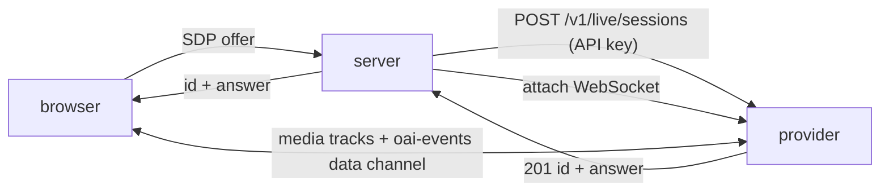

# Tech doc: WebRTC transport

The only transport in milestone 1. Audio flows browser to provider directly over WebRTC; the server exchanges SDP with the provider's API key and then attaches to the session over WebSocket to receive events and send appends. The browser never sees a provider credential.

Package `@duplexd/transport-webrtc` in `packages/transports/webrtc`. Server-side only in milestone 1; the browser-side peer connection code lives in the console. Depends on `@duplexd/core` and the `openai` SDK.

## What is verified

From [provider-facts.md](provider-facts.md): `POST /v1/live/sessions` with `{ session, transport: { type: "webrtc", sdp } }` from the app server using the project key; 201 with `session.id` and the SDP answer; browser data channel `oai-events`; server attach at `wss://api.openai.com/v1/live/sessions/{id}/attach`; the SDK call `client.live.create(...)`. No ephemeral browser token exists or is needed.

## Design



Server-side API:

```
createWebRtcSession(deps: { client: OpenAI, adapter: ProviderAdapter }, input: {
  config: SessionConfig
  sdpOffer: string
}): Promise<{ sessionId: string, sdpAnswer: string }>
```

Steps:

1. Map `SessionConfig` to the provider `session` object: `model: "gpt-live-1"`, `delegation: { type: "client" }`, `instructions`, `voice` if set. `audio` is omitted for WebRTC. Nothing else from the config is sent; `consumerContext` and `handler` never leave the server.
2. `client.live.create({ session, transport: { type: "webrtc", sdp } })`. `maxRetries: 0` on the client (a retried create is a second provider session and a second charge).
3. `adapter.attach(session.id)` and wait for the attach connection to be open before returning, so the browser cannot complete ICE before the broker is listening.
4. Return id and answer.

If step 3 fails, the transport calls `adapter.abandon(session.id)` before throwing, and the thrown error carries the abandon result so the server can record it. A provider session that was created and never attached is otherwise a live, unobservable session nobody will close.

The provider session id is the duplexd session id, unchanged. There is no local id.

Browser-side (in the console, described here because it is the other half of the transport):

- `getUserMedia({ audio: true })`, add the track, `createDataChannel("oai-events")`, `createOffer`, `setLocalDescription`.
- `POST /v1/sessions` with the offer; `setRemoteDescription(answer)`.
- Play the remote track on an `<audio autoplay>` element with no buffering of our own. The model handles barge-in; the browser does nothing special for interruption.
- Data channel messages are shown in the console's raw debug panel only. The console's transcript and timeline come from the server's event stream, so there is one source of truth and the browser is never a control path.

## Invariant notes

- **Secrets stay server-side.** The browser receives the session id and the SDP answer. Verified that this is how the provider intends WebRTC to work.
- **Delegation events are metadata.** The broker consumes `session.delegation.created` only from the attach connection. The data channel also carries it, but the server never accepts a delegation from the browser. T05 confirms on a live WebSocket session that an attach connection receives delegation events, before the server is built on that assumption. If it does not, the correct outcome is a failed session, a blocked acceptance item, and an ADR, not a browser relay.

## Open risks the ticket must measure

| Risk | What to do |
| --- | --- |
| Events between create and attach are not replayed | Time the gap; provoke an early transcript; if lost, document the window and confirm `session.started` still arrives on attach. If `session.delegation.created` can be lost in that window, escalate to an ADR. |
| No way to close a created-but-unattached provider session | Check whether a REST delete or close exists for a live session. Implement `abandon` with it if so; with a short-lived attach plus `session.close` otherwise. Record which in [provider-facts.md](provider-facts.md). |
| The attach connection does not receive `session.closed` when the browser closes the peer connection | Test both endings: console close (server sends `session.close`) and tab close (peer connection drops). Record which produce `closed` versus `incomplete`. |
| ICE fails on a network with no STUN reachability | Out of scope; note the failure mode in the console as a `failed` session with the browser's ICE state in the reason. |
| SDK `client.live.create` response shape differs from docs | Validate the response with a Zod schema in the transport; a mismatch is a typed error, not an `undefined` id. |

## Tests

`pnpm --filter @duplexd/transport-webrtc test`: the mapping from `SessionConfig` to the provider session object (no leakage of `consumerContext`, `handler`, or audio); response validation; attach-before-return ordering with a stubbed client and a fake adapter; error propagation when create fails (no attach attempted, no abandon) and when attach fails (`abandon` called with the id, its result on the thrown error, create result logged with id only).

Live: a recorded browser session from the console against the real provider with the Node example handler. `AGENTS.md`: a transport change requires a recorded live session, and a fixture pass is not a live pass.

## Acceptance evidence

Report each as passed, failed, blocked, or not run:

- `pnpm --filter @duplexd/transport-webrtc lint`, `typecheck`, `test` pass.
- A browser call connects, the model speaks, the caller interrupts mid-sentence, and the model recovers. Recorded, with the session id.
- The delegation round trip works over the attach connection: `delegation.created` observed by the server, the remote handler called, `commentary` spoken. The model keeps talking during the handler's simulated delay.
- Closing from the console produces `session.closed` with usage; closing the tab produces the state the measurement found, and that finding is written into `ARCHITECTURE.md`.
- The console never receives the provider API key, verified by inspecting the `POST /v1/sessions` response and the event stream in the browser's network panel, with a screenshot or HAR excerpt in the PR.
- The create-to-attach replay question is answered in the PR and in `docs/PROTOCOL.md`'s provider mapping section, or escalated as an ADR.
- Whether a created-but-unattached session can be closed is answered, `abandon` is implemented accordingly, and the provider-facts row is moved to verified.
